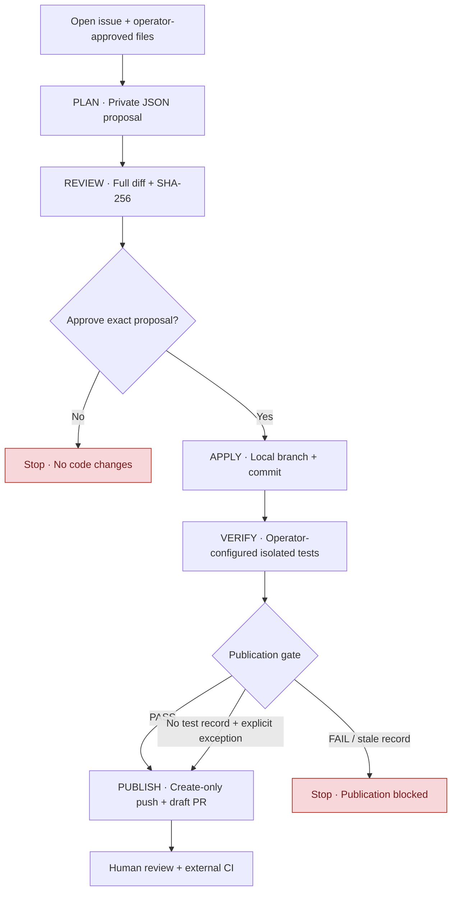

<div align="center">

# GitHub Engineering Agent

**From GitHub issues to controlled, reviewable draft pull requests.**

A lightweight Python CLI that separates AI-generated proposals from deterministic validation, explicit approval, and remote publication.

[](https://github.com/jsmlabs/github-engineering-agent/actions/workflows/offline-verification.yml)


[Get started](#quick-start) · [Explore the workflow](#workflow-at-a-glance) · [Compare modes](#choose-a-workflow) · [Safety](#safety-and-limits) · [Documentation](#documentation-map)

</div>

> [!IMPORTANT]
> **Reference implementation, not a production-validated autonomous engineer.** The CLI may commit approved edits and publish a **draft** pull request, but it does not approve, merge, or deploy changes. The isolated verification command runs only an operator-configured test. Real OpenAI/GitHub end-to-end operation remains unverified.

## At a glance

| Scope | Control | Output |
| :--- | :--- | :--- |
| **One open issue** and **1–5 approved tracked files** | Deterministic file, content, revision and change-budget checks | A private, inspectable proposal |
| **Explicit local approval** tied to proposal SHA-256 | Local branch, commit and exact Git-object validation | A recorded local commit |
| **Commit-bound verification** or an explicit exception | Remote precondition checks and create-only branch push | An **open draft PR**, never an automatic merge |

## Workflow at a glance



**Recommended path:** `plan → review → apply → verify → publish`. The optional `run` command skips the proposal-specific review pause; it still requires explicit permissions, deterministic checks, and a verification record or allowed exception. No path automatically merges or deploys.

### Command reference

| Command | Outcome | Authorization |
| --- | --- | --- |
| `plan` | Private JSON proposal; **two** model requests | `--allow-source-upload`, explicit `--allowed-file` scope |
| `review` | Full unified diff, exact proposal SHA-256; no mutation | None |
| `apply` | New local branch, validated commit, private receipt | `--approve` and matching `--expected-sha256` |
| `verify` | Container-isolated, commit-bound test record | Pinned image and explicit command |
| `status` | Read-only local recovery view; optional remote ref check | None |
| `publish` | Create-only push, verified **draft** PR after passing gate | `--approve-publish`, verification or explicit exception |
| `run` | Opt-in `plan → apply → verify/gate → publish` without an inspection pause | Source-upload, local-write and remote-publish approvals; test configuration or explicit exception |

## Quick start

### 1. Prepare a trusted environment

- Python **3.11+**, Git in `PATH`, and a private location for proposal files **outside** the target checkout.
- A clean, dedicated checkout on the target repository's **default branch**, at the fetched `origin/<default>` commit. The `origin` fetch and push URL must exactly identify the requested GitHub repository (HTTPS or supported GitHub SSH form); multiple push destinations are rejected.
- `GITHUB_TOKEN`: repository-scoped GitHub credential with **Issues: read** for planning; publishing additionally needs **Contents: write** and **Pull requests: write**, plus separately configured Git push credentials (credential helper or SSH). GitHub repository policies may require further approval.
- `OPENAI_API_KEY`: credential for a model compatible with the Responses API's strict JSON-schema Structured Outputs. Independently verify model access, data processing, pricing, and applicable organizational policies.

Run in an isolated, trusted workspace. The tool does not sandbox Git, source content, credential helpers, or generated code. **Do not place tokens in Git remote URLs, proposals, or shell command arguments.**

### 2. Install and check the CLI

From this repository:

```bash
python -m pip install --no-build-isolation .
gh-engineer --help
python scripts/verify.py
```

Or run without installing: `python -m gh_agent --help`. Runtime Python dependencies are limited to the standard library. The local verification script runs offline tests and smoke checks; it is **not** a live service test.

### 3. Plan and inspect (no repository mutation)

Substitute a real open issue, an existing tracked file, an accessible model, and absolute paths:

```bash
python -m gh_agent plan \
  --repo OWNER/REPO --issue 123 \
  --checkout /absolute/path/to/checkout \
  --model YOUR_STRUCTURED_OUTPUT_MODEL \
  --allowed-file src/feature.py \
  --allowed-file tests/test_feature.py \
  --allow-source-upload \
  --output /private/location/issue-123.json

python -m gh_agent review \
  --checkout /absolute/path/to/checkout \
  --proposal /private/location/issue-123.json
```

`plan` uploads the issue text and the selected source content to the configured model provider only after explicit consent. It writes the proposal with file mode `0600` (subject to filesystem semantics) and normally prints **paths and metadata only**. `review` displays the **full proposed source diff** in your terminal, plus its SHA-256 digest. Avoid forwarding terminal transcripts or the proposal JSON to untrusted services.

### 4. Apply only the reviewed proposal

```bash
python -m gh_agent apply \
  --checkout /absolute/path/to/checkout \
  --proposal /private/location/issue-123.json \
  --expected-sha256 COPY_EXACT_SHA256_FROM_REVIEW \
  --approve
```

`apply` rechecks the clean checkout, base commit, authorized file set and content, creates a local `agent/issue-<number>-<base-sha-prefix>` branch, and commits the approved replacements. It writes `<proposal>.applied.json` outside the checkout. The reviewed digest binds ordinary edits to the specific proposal file; it is **not a cryptographic signature** against a local attacker controlling both proposal and receipt.

**Before publication:** inspect the commit and arrange independent review. The optional `verify` command can run an operator-selected test command in a constrained Docker container on supported POSIX hosts; the agent does **not** automatically select the target project's full test suite or determine semantic correctness.

### 5. Verify the exact commit before publishing

Use a trusted, preloaded OCI/Docker image pinned by its SHA-256 digest. The operator supplies an explicit argv array. Docker is an external trusted dependency: run with a trusted rootless/isolated daemon, not a shared privileged host daemon. The checkout is mounted read-only; the container has no network or Linux capabilities, and receives no application credentials by design, with memory/CPU/PID and time limits. The runner currently requires a POSIX host path (native Windows Docker verification is unsupported). Docker is required for isolated test execution, not for the offline CLI tests.

```bash
python -m gh_agent verify \
  --checkout /absolute/path/to/checkout \
  --proposal /private/location/issue-123.json \
  --image registry.example/test-image@sha256:YOUR_64_HEX_DIGEST \
  --command-json '["python","-m","unittest","discover","-s","tests"]' \
  --timeout 120
```

The private `.verified.json` record is tied to the approved proposal SHA and exact local commit. A failing test is a hard block. If tests cannot be run, `publish` requires both `--approve-unverified` and a substantial `--unverified-reason`; this does not override recorded test failures. Rechecking without changing the commit requires inspecting/removing the old verification record through a deliberate operator action.

### 6. Publish as a draft pull request

```bash
python -m gh_agent publish \
  --checkout /absolute/path/to/checkout \
  --proposal /private/location/issue-123.json \
  --approve-publish
```

`publish` checks the receipt and exact committed Git objects, issue update timestamp, default branch and current remote refs. It pushes the specific new branch using a **create-only lease**, then creates or verifies an **open draft PR** with the expected head commit. A closed PR, changed base, ambiguous search result or unexpected remote branch blocks publication.

Check recovery state after an interrupted apply/publish:

```bash
python -m gh_agent status --checkout /absolute/path/to/checkout \
  --proposal /private/location/issue-123.json --remote
```

`status` never changes local or remote state. `publish` reconciles an existing exact branch and draft PR before writing and refuses conflicting remote state. An explicit exception for unavailable tests is:

```bash
python -m gh_agent publish --checkout /absolute/path/to/checkout \
  --proposal /private/location/issue-123.json --approve-publish \
  --approve-unverified --unverified-reason "Trusted test image unavailable in offline worker"
```

## Choose a workflow

| | Reviewed workflow | Opt-in autonomous draft |
| --- | --- | --- |
| Sequence | `plan → review → apply → verify → publish` | `run` (verification configured or explicit exception) |
| Proposal-specific human inspection | **Yes** | **No** |
| Allowed files | Operator-defined | Operator-defined |
| Allowed remote effect | Draft PR | Draft PR |
| Merge/deploy | Never | Never |
| Suitable use | Normal operation | Isolated, low-risk experiments with external review gates |

The **high-trust** alternative deliberately authorizes both local and remote effects up front:

```bash
python -m gh_agent run \
  --repo OWNER/REPO --issue 123 \
  --checkout /absolute/path/to/checkout \
  --model YOUR_STRUCTURED_OUTPUT_MODEL \
  --allowed-file src/feature.py \
  --output /private/location/issue-123.json \
  --allow-source-upload --approve-local --approve-publish \
  --test-image registry.example/test-image@sha256:YOUR_64_HEX_DIGEST \
  --test-command-json '["python","-m","unittest","discover","-s","tests"]'
```

Use `run` only if your process allows publishing **unreviewed AI-generated edits as drafts**. Without a configured test image and command, `run` requires both `--approve-unverified` and a justified `--unverified-reason` before planning. The agent may stop partway through after a commit or push; review its actual state before retrying.

## Safety and limits

The offline GitHub Actions matrix uses GitHub-hosted runners and pins the official checkout/setup-python v7 actions to verified immutable commit SHAs. Credentials are not persisted during checkout; jobs have read-only repository permission and a bounded execution timeout.


| Guard | Implemented contract |
| --- | --- |
| File scope | **1–5** distinct, explicitly authorized, **existing tracked** UTF-8 files |
| Size limits | **20,000 bytes/file**, **55,000 bytes total**; up to **400 changed lines**, **85,000-byte proposal diff** |
| Repository size | At most **1,000 eligible tracked source files**; allowed extensions only |
| Issue input | One **open issue** (not a PR); bounded title/body; timestamp required |
| Model execution | **Two requests** in `plan`; fixed request limits and timeouts; no model-suggested shell commands |
| Validation | Exact paths, source SHA-256, proposed content, Python/JSON syntax, `git diff --check`, committed blob bytes |
| Remote | Exact branch/repository identity, clean local state, no force-overwrite, issue/base recheck, open-draft-PR verification |
| Explicitly denied | Merge, deployment, review approval, workflow edits, model-proposed shell commands; tests require an operator-supplied command |

Checks for common credentials, terminal-control characters and unsafe paths help reduce exposure, but **are not complete DLP, security review or code correctness checks**. Syntax validation is implemented for Python and JSON; JSON source files reject duplicate object keys and non-finite numeric constants (`NaN`, `Infinity`, `-Infinity`). Other permitted formats need their own trusted validators. See [SECURITY.md](SECURITY.md) for trust boundaries and remaining risks.

## Recovery and common failures

| Symptom | Safe next action |
| --- | --- |
| `Checkout must be completely clean` | Inspect `git status`; isolate existing changes before proceeding. Do not discard them. |
| `Local base is not at the known origin/base commit` | Fetch and inspect the target branch manually; replan if the base changed. |
| `Stale base revision` / updated issue | Regenerate a new plan against the current issue and checkout. |
| SHA-256 mismatch | Re-run `review` and inspect the current file; never reuse an old digest blindly. |
| `LOCAL_APPLY_INCOMPLETE` | Inspect current branch, worktree and commit state; **no automatic rollback** occurs. |
| Remote collision or uncertain push | Inspect exact remote branch and PR head before any retry. No blind replay. |
| PR was closed or search is incomplete | Resolve manually; the agent deliberately fails closed. |
| HTTP/API failure | Check credentials, service availability and quota without logging secrets; live API compatibility is not verified. |

For state transitions and failure boundaries, read [Architecture and recovery](docs/ARCHITECTURE.md). A partially successful remote push **does not** imply that a PR exists, and a draft PR **does not** imply successful tests, mergeability or production readiness.

## Documentation map

| File | What it owns |
| --- | --- |
| [`docs/ARCHITECTURE.md`](docs/ARCHITECTURE.md) | Components, trust boundaries, execution states, retry and recovery contracts |
| [`SECURITY.md`](SECURITY.md) | Threat model, denied capabilities, residual risk and incident response |
| [`VERIFICATION.md`](VERIFICATION.md) | Dated offline checks, observed evidence and validation gaps |
| [`CHANGELOG.md`](CHANGELOG.md) | Version history and compatibility changes |
| `gh_agent/core.py` | Git identity, path scope, source/proposal checks and Git-object validation |
| `gh_agent/services.py` | Bounded GitHub/OpenAI HTTPS clients and response parsing |
| `gh_agent/cli.py` | Command-line approvals and plan/review/apply/publish/run orchestration |
| `tests/test_agent.py` | Offline deterministic tests with temporary repositories and mocked services |
| `scripts/verify.py` | Reproducible local verification entry point |

## Compatibility and provenance

**Proposal schema 2 is unchanged; the verification record has its own schema 1.** v0.2.0 uses proposal schema 2. v0.1.0/schema-1 proposals and receipts are **not** compatible. Recreate proposals with explicit file authorization. No in-place migration is provided. This is a standalone CLI, not a background agent or hosted service; it has no job queue, scheduling, automatic target-test selection, proof of business-invariant preservation, or automatic merge/deploy support.

Architecture and engineering conventions are informed by the separately maintained [AI Agent Execution Contracts](https://github.com/jsmlabs/chatgpt-context/blob/main/knowledge/ai-agent-execution-contracts.md), [Agent Workflow Architect](https://github.com/jsmlabs/chatgpt-context/blob/main/prompts/agent-workflow-architect.md), [Repository Engineering Execution](https://github.com/jsmlabs/chatgpt-context/blob/main/instructions/repository-engineering-execution.md), and [Verification Engineering](https://github.com/jsmlabs/chatgpt-context/blob/main/instructions/verification-engineering.md). Implementation-specific evidence takes precedence over aspirational specifications.

API reference: [OpenAI Responses](https://developers.openai.com/api/reference/resources/responses/methods/create), [Structured Outputs](https://developers.openai.com/api/docs/guides/structured-outputs?api-mode=responses), [GitHub REST](https://docs.github.com/en/rest/about-the-rest-api/api-versions). Revalidate vendor behavior, API versions, authentication, model capabilities and policies before live use.
